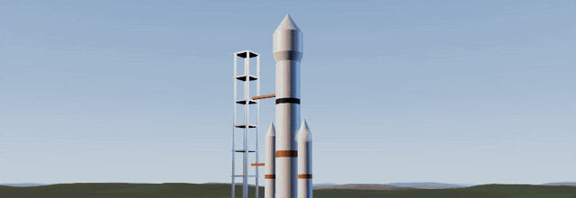
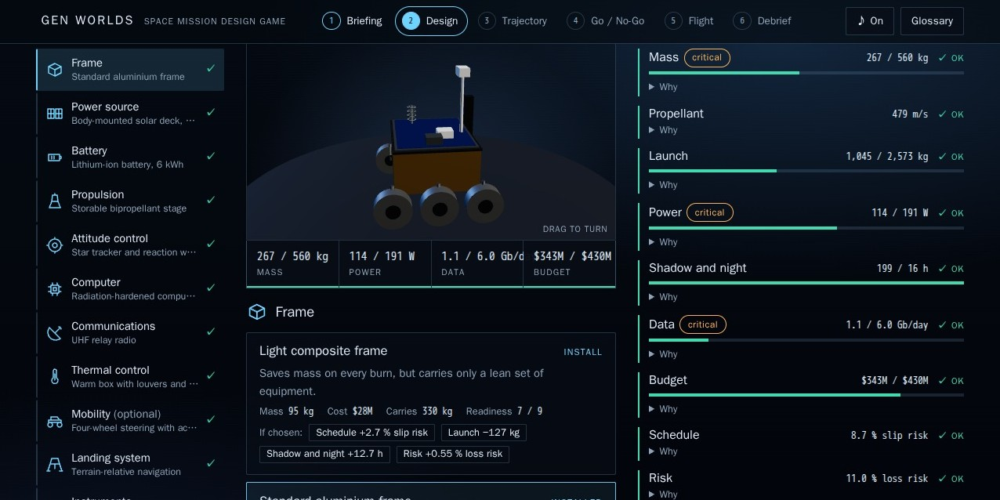
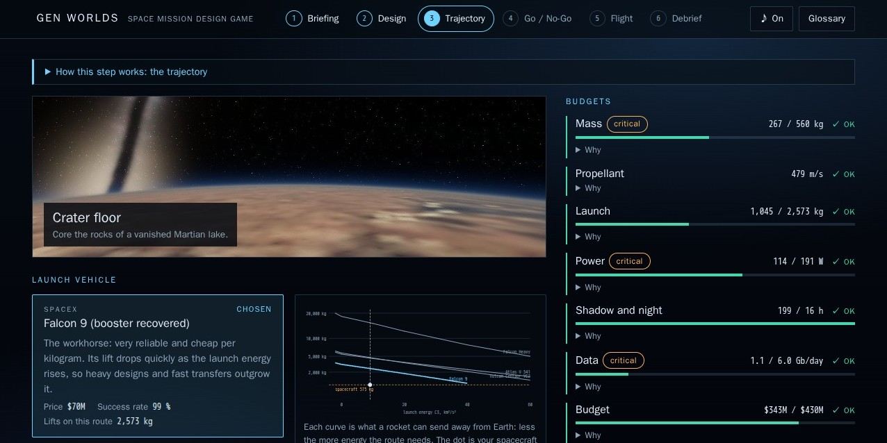
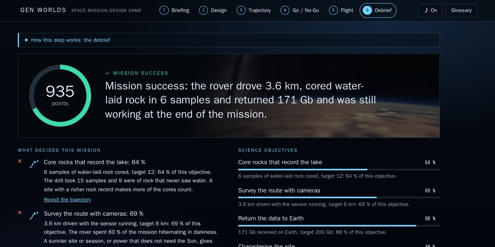
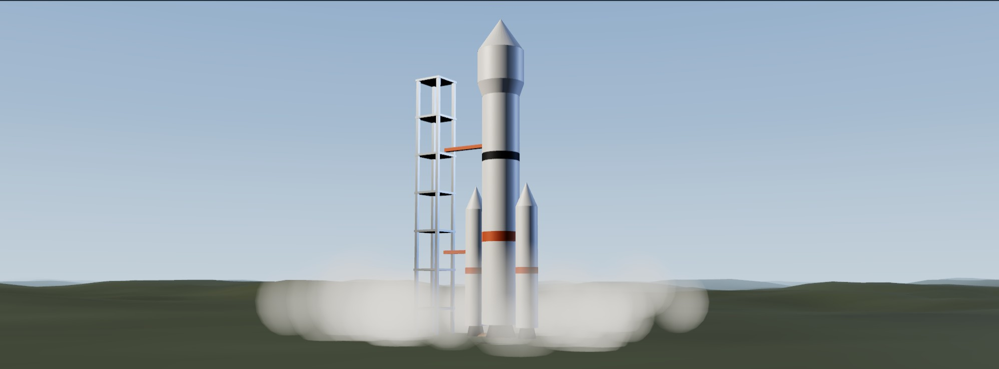
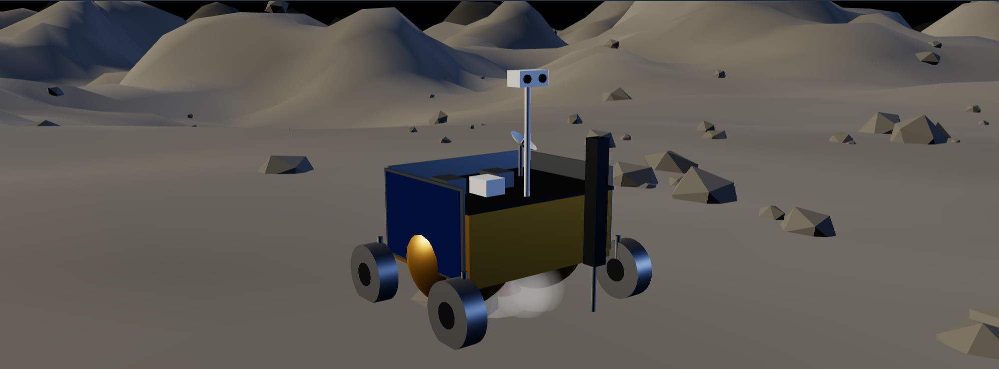
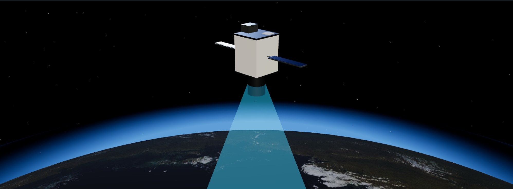

<!-- Gen Worlds © 2026 Echo Yin. Licensed under Apache-2.0: see LICENSE.md. -->
<a href="https://gen-worlds.surf"></a>

<h1 align="center">Gen Worlds</h1>

<p align="center">
  <b>A space mission design game for 1 to 4 players.</b><br>
  Plan a NASA-style mission from the science goal to the spacecraft to the launch,<br>
  then fly it and see every trade-off play out.
</p>

<p align="center">
  <a href="https://gen-worlds.surf"></a>
  <a href="https://gen-worlds.surf/gen-worlds-demo.mp4"></a>
  <a href="media/README.md"></a>
</p>

<!-- Live: the site and deploy status, and endpoint badges written by tools/badges.mjs on every deploy. -->
<p align="center">
  <a href="https://gen-worlds.surf"></a>
  <a href="https://github.com/e-choness/nasa-space-app-calgary/actions/workflows/deploy.yml"></a>
  
  
  
  <a href="LICENSE.md"></a>
  <a href="https://www.spaceappschallenge.org/"></a>
</p>

<!-- What is in the game, counted from src/data on every deploy. -->
<p align="center">
  
  
  
  
  
  
</p>

<!-- The stack, with versions read from package.json on GitHub. -->
<p align="center">
  
  
  
  
  
  
</p>

<!-- The repository, live from GitHub. -->
<p align="center">
  
  
  
  
  <a href="https://github.com/e-choness/nasa-space-app-calgary/stargazers"></a>
</p>

<p align="center">
  
  <br><sub>After launch the mission log plays out in 3D with the vehicle you designed. Staged for clarity, not to scale.</sub>
</p>

Built for the **NASA Space Apps Challenge 2026** (Calgary), challenge *Space Mission Design Game*.
Runs in any modern browser with nothing to install; the 3D views need WebGPU, and the whole game
also plays without it.

## What you do

1. **Briefing.** Read the science objectives, the budget cap and the resources that usually decide
   the mission.
2. **Hangar.** Choose a part for every system: frame, power, battery, propulsion, attitude control,
   computer, radio, thermal control, mobility, landing system and instruments. Nine budgets (mass,
   propellant, launch, power, night or eclipse, data, cost, schedule, risk) update live, each with a
   sentence that says *why* it is healthy or not. The vehicle is built in 3D as you choose.
3. **Trajectory.** Choose the rocket, the route and the dates: a sunlight and Earth-visibility
   calendar for the lunar pole, a porkchop plot for Mars, an altitude trade for Earth orbit.
4. **Go/No-Go.** Each role answers for its part of the mission. A forecast flies the design 200 times
   to show how often it works and what usually goes wrong.
5. **Flight.** The mission plays out day by day with a dashboard of sunlight, Earth in view, battery
   and data. On the Moon and on Mars you can fly the last kilometres of the landing yourself in 3D
   over the real terrain, with the
   propellant your design left you.
6. **Debrief.** Every outcome is traced back to the design decision behind it, with a link to the
   screen where you can change it. Change one thing, fly again, compare.

<table>
  <tr>
    <td width="33%"></td>
    <td width="33%"></td>
    <td width="33%"></td>
  </tr>
  <tr>
    <td align="center"><sub><b>Hangar.</b> Every part moves the budgets, with the reason.</sub></td>
    <td align="center"><sub><b>Trajectory.</b> Launch windows from real ephemerides.</sub></td>
    <td align="center"><sub><b>Debrief.</b> The decision behind each outcome.</sub></td>
  </tr>
  <tr>
    <td></td>
    <td></td>
    <td></td>
  </tr>
  <tr>
    <td align="center"><sub><b>Launch</b> from the pad.</sub></td>
    <td align="center"><sub><b>Moon:</b> the ice prospector at the south pole.</sub></td>
    <td align="center"><sub><b>Earth orbit:</b> the imager at work.</sub></td>
  </tr>
</table>

## Missions

| # | Mission | What it teaches |
| --- | --- | --- |
| 1 | Earth observation small satellite | Mass, power, data and cost; orbit altitude against image detail, ground contact, drag and the debris rule |
| 2 | Lunar south pole ice prospector | Polar lighting, the lunar night, working in permanent shadow, direct-to-Earth links |
| 3 | Jezero crater sample survey (Mars) | Launch windows, entry speed, dust, nights every sol, relay links, light time |

**And any world in the galaxy.** The galaxy is procedural, and every solid planet and moon in it is
a mission. Open the **galaxy map** from the mission screen (a 3D chart of the stars near you that you turn and zoom, each system's planets
and moons on their orbits, a searchable list, and what each world demands), or fly to a world in
the sandbox and press P:
its gravity sets the propellant, its distance from its star the power, its day the battery, and its
air decides between a heat shield and engines. The same rover that works on Mars may not survive
there. The landing is flown over that world's own terrain.

Three difficulty levels (Cadet, Engineer, Flight Director) change the catalog, the budget and how
often things go wrong. Every step has a short explainer, and a glossary of the terms is one click
away.

## Playing together

- **Around one screen:** two to four players take the roles of Flight Director, Spacecraft Engineer,
  Science Lead and Comms and Operations. Each role owns part of the design, votes in the Go/No-Go
  poll and has to acknowledge its own events in flight; fast answers earn a coordination bonus.
  Roles can send each other requests ("Science asks Engineering for 4 kg").
- **Each on their own device:** the same, through a room code (needs the online service configured,
  see below).
- **Against each other:** the simulation is deterministic, so a link to a flight hands anyone the
  same design and the same luck. There is a daily mission with one seed for everybody, and a
  leaderboard on which every entry is re-flown by your browser before it is shown.

## A tour without playing

<https://gen-worlds.surf/?demo> flies a camera over the real Earth, Moon and Mars and down to the
two landing sites. Press R to record the view to a WebM file, Esc to leave. It needs WebGPU.

## How it works

- **One mission model.** A design is plain data. `evaluateDesign` turns it into budgets with
  explanations; `simulateMission(design, seed, inputs)` turns it into a result. The forecast, the
  flight, the debrief and the leaderboard check all call the same functions, so they cannot disagree.
- **Real physics, simplified honestly.** JPL Keplerian elements for the planets, a Lambert solver
  for transfers, the rocket equation, inverse-square solar power and link budgets, a lunar ephemeris
  with libration for polar lighting, sun-synchronous orbit geometry, eclipse and drag.
- **Data, not code.** Parts, launch vehicles, bodies, scenarios and events live in JSON under
  `src/data/`, each file with its sources and units. [`CREDITS.md`](CREDITS.md) lists every dataset,
  texture, library and technique with its licence.
- **3D.** three.js with the WebGPU renderer: the real solar system at ephemeris positions; the Moon
  (NASA LOLA elevation, LROC colour), Mars (MOLA elevation, Viking colour) and the Earth (Blue
  Marble colour, ETOPO relief) from measured maps; a procedural galaxy to explore in the sandbox.
- **The flight in 3D.** After launch the mission log is played out on a small 3D stage with your own
  vehicle: lift-off from the pad, the coast between worlds, the parachute and landing burn, the rover
  driving or the satellite scanning. It is staged for clarity, not to scale, and falls back to a still
  picture without WebGPU.
- **Preloading.** While you are on the title and briefing screens, the pictures, the 3D code and
  the maps and textures of the screens ahead download in the background, one at a time. The large
  3D files are skipped without WebGPU and on connections that ask to save data.

## Run it locally

Everything runs in Docker; nothing is installed on the host.

```sh
docker compose up -d web                                       # dev server on http://127.0.0.1:5173
docker compose run --rm tools sh -c "npm run typecheck && npm run lint && npm test"
docker compose run --rm capture node tools/capture.mjs "#/scenarios" shots/scenarios.png
```

### Online rooms and the global leaderboard (optional)

The game plays fully offline. To enable rooms across devices and the global leaderboard, create a
Firebase project with **Firestore** and **anonymous sign-in**, publish the rules in
[`firestore.rules`](firestore.rules), and put the web config in `.env.local` (see
[`.env.example`](.env.example)). The web config is public by design; the rules are the access
control.

The database and the rules can be set up from the command line by an owner of the Firebase project
(the login is kept under `.cache/`, never committed):

```sh
docker compose run --rm firebase login --no-localhost
docker compose run --rm firebase firestore:databases:create "(default)" --location nam5
docker compose run --rm firebase deploy --only firestore:rules
```

## Layout

```
src/core      random streams, disposal, settings
src/data      typed JSON catalogs and their loaders
src/astro     ephemeris, Kepler, Lambert, orbits, lunar and planetary sky
src/universe  bodies and procedural content for the renderer
src/mission   design, budgets, validation, simulation, scoring, debrief
src/engine    renderer and frame loop
src/render    planets, atmosphere, space, effects, the hangar vehicle
src/player    flight and descent controls
src/ui        2D screens (Preact)
src/coop      rooms, net adapters, leaderboard
src/app       the store and the shell that wire it together
```

Imports point downward only. `core`, `data`, `astro`, `universe` and `mission` are pure and run in
workers.

## AI use

The code was written with Claude Code (Anthropic) under the team's direction, and the music and
sound effects were generated with a locally run audio model. Details are in
[`CREDITS.md`](CREDITS.md).

## Demo video and media kit

- **Demo:** [29 seconds](https://gen-worlds.surf/gen-worlds-demo.mp4), the whole loop from design
  to debrief ([`public/gen-worlds-demo.mp4`](public/gen-worlds-demo.mp4)). It is recorded from the
  running game by `tools/record-video.mjs`, which steps the page's clock one frame at a time in the
  capture container, and encoded with ffmpeg at 30 frames per second.
- **[Media kit](media/README.md):** logo and wordmarks, the animated banner (SVG and GIF), the social
  card, app icons, twelve screenshots, the flight GIF, descriptions of three lengths, a fact sheet,
  colours and type. All of it is generated from the game by `tools/media/`.
- **Live badges:** the tests, content and size badges at the top are endpoint files written by
  [`tools/badges.mjs`](tools/badges.mjs) on every deploy and served from the site, so they always
  describe what is live.

## Licence

Gen Worlds is open source, © 2026 Echo Yin, under the
[Apache License 2.0](LICENSE-APACHE); see [`LICENSE.md`](LICENSE.md).
Third-party maps and textures keep their own terms, listed in [`CREDITS.md`](CREDITS.md).
