<!-- Gen Worlds © 2026 Echo Yin. Licensed under Apache-2.0: see LICENSE.md. -->
<p align="center"></p>

# Gen Worlds media kit

Everything needed to write about, present or share Gen Worlds. Free to use for coverage, judging,
classroom and community posts about the game. Please don't alter the logo or imply endorsement by
NASA or any space agency.

**Play:** <https://gen-worlds.surf> · **Code:** <https://github.com/e-choness/nasa-space-app-calgary> ·
**Demo video (29 s):** <https://gen-worlds.surf/gen-worlds-demo.mp4>

## The game in one line

Design a NASA-style space mission, then fly it and watch every trade-off play out.

## Short description (about 50 words)

Gen Worlds is a free browser game in which one to four players design a space mission (objective,
spacecraft, rocket, route) under nine live budgets that explain every trade-off, then fly it in 3D.
Real NASA data sets the launch windows and terrain, and the debrief traces each outcome back to the
decision that caused it.

## Long description (about 150 words)

Spaceflight is the art of living inside budgets. In Gen Worlds a kilogram added to the rover becomes
more propellant and a bigger rocket; a battery skimped on freezes the vehicle in a lunar night whose
length comes from the real Moon. Players choose every system of the spacecraft while mass,
propellant, launch, power, night, data, cost, schedule and risk update live, each with a sentence
that says why. They pick the rocket and dates on a porkchop plot or a lighting calendar computed from
real ephemerides, hold a Go/No-Go poll across four roles, and launch. The flight plays out on a 3D
stage with their own vehicle, from lift-off to the landing burn to the rover at work, and the
debrief names the decision behind every result. Three NASA-based missions (Earth observation, a
lunar south pole ice prospector, a Mars sample survey) are joined by any solid world of a generated
galaxy. Built for the NASA Space Apps Challenge 2026 in Calgary.

## Fact sheet

| | |
| --- | --- |
| Genre | Mission design and simulation, educational |
| Players | 1 to 4 on one screen, or one device each through a room code |
| Platform | Any modern browser; 3D views need WebGPU, the whole game plays without it |
| Price | Free, no install, no account |
| Missions | Earth-observation satellite, lunar ice prospector, Mars Jezero survey, and any generated world |
| Data | NASA JPL ephemerides, LRO LOLA and LROC, MGS MOLA, Viking, Blue Marble, NOAA ETOPO, NSSDCA fact sheets |
| Built with | TypeScript, three.js (WebGPU), Preact, Vite |
| Event | NASA Space Apps Challenge 2026, Calgary local event; challenge *Space Mission Design Game* |
| Team | Echo Yin (solo) |
| Licence | Apache-2.0 for the code and these assets; NASA and other third-party imagery keeps its own terms (see [`CREDITS.md`](../CREDITS.md)) |

## Logo

| | File | Use |
| --- | --- | --- |
|  | [`logo/mark.svg`](logo/mark.svg), [`icons/mark-512.png`](icons/mark-512.png) | The mark alone: avatars, favicons, small spaces |
| 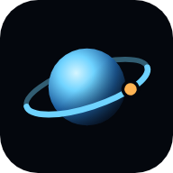 | [`icons/app-icon-512.png`](icons/app-icon-512.png), [`icons/app-icon-192.png`](icons/app-icon-192.png) | App icon on its dark tile |
|  | [`logo/wordmark-light.svg`](logo/wordmark-light.svg), [`@4x.png`](logo/wordmark-light@4x.png) | Wordmark for dark backgrounds |
|  | [`logo/wordmark-dark.svg`](logo/wordmark-dark.svg), [`@4x.png`](logo/wordmark-dark@4x.png) | Wordmark for light backgrounds |

The mark is a world, its orbit, and a spacecraft on it. Keep clear space of half the mark's height
around it; don't recolour, stretch or add effects.

## Banners and social

| Preview | File | Size | Use |
| --- | --- | --- | --- |
| 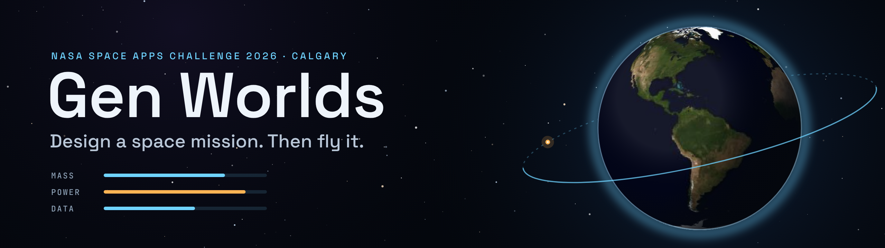 | [`banners/banner-animated.svg`](banners/banner-animated.svg) | 1280 × 360, 300 kB | Animated header (README, web pages): the Earth turns, a spacecraft orbits, a rocket climbs, the budgets fill |
| | [`banners/banner-animated.gif`](banners/banner-animated.gif) | 960 × 270, 12 s loop | The same where SVG animation is not shown (forums, chat, slides) |
| | [`banners/banner.png`](banners/banner.png) | 2560 × 720 | Still header |
| 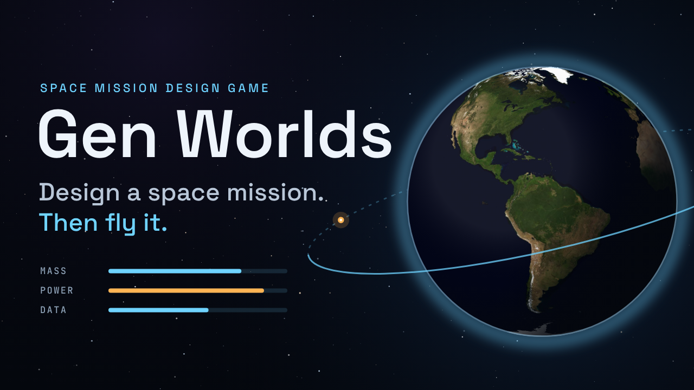 | [`banners/youtube-thumbnail.png`](banners/youtube-thumbnail.png) | 1280 × 720, 600 kB | YouTube thumbnail (16:9): the banner recomposed to read at thumbnail size |
| 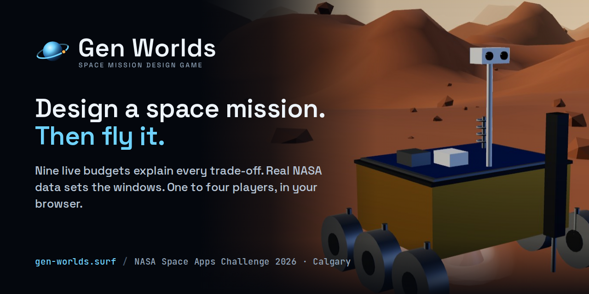 | [`banners/social-preview.png`](banners/social-preview.png) | 1280 × 640 | GitHub social preview, Open Graph and X/Twitter cards (also served as `og-image.png` by the site) |

## Motion

| Preview | File | Use |
| --- | --- | --- |
| 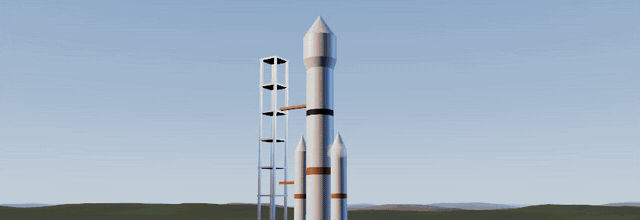 | [`gameplay-flight.gif`](gameplay-flight.gif) (640 px, 13 s, 4 MB), [`gameplay-flight.mp4`](gameplay-flight.mp4) (1672 × 576) | The flight in 3D: launch, cruise, parachute and landing on Mars, the rover at work |
| | [Demo video](https://gen-worlds.surf/gen-worlds-demo.mp4) (1280 × 720, 29 s, captions burnt in) | The whole loop: design, trajectory, flight, debrief |

## Screenshots

| | | |
| --- | --- | --- |
| 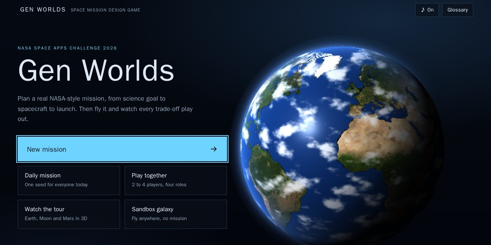 | 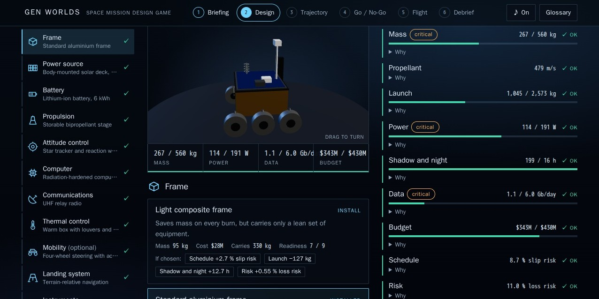 | 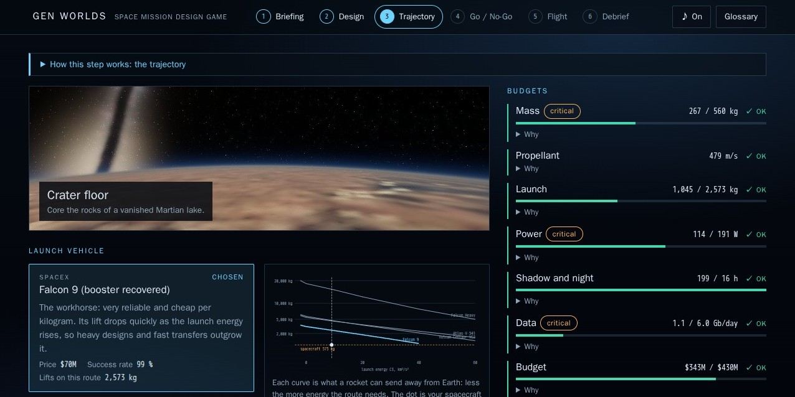 |
| Title | Hangar: parts, budgets, 3D vehicle | Trajectory: rocket and launch windows |
| 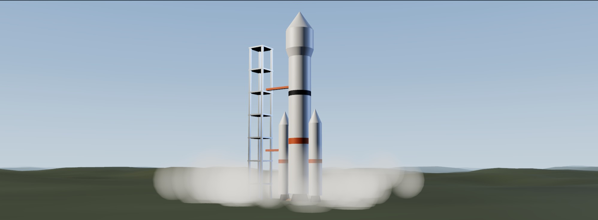 | 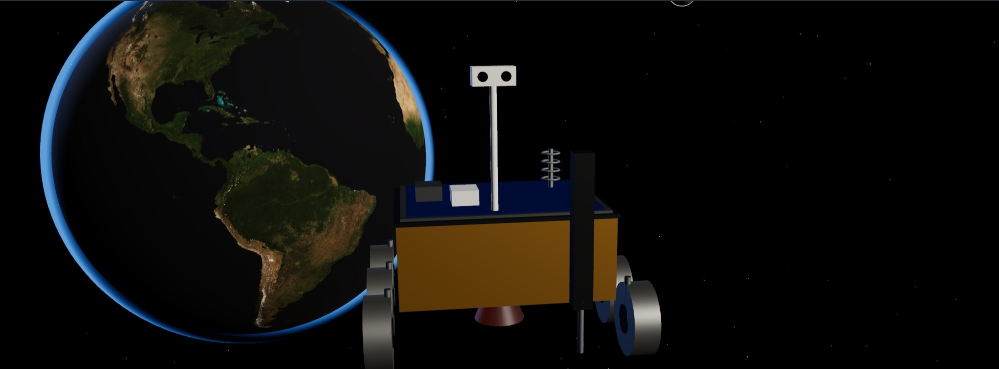 | 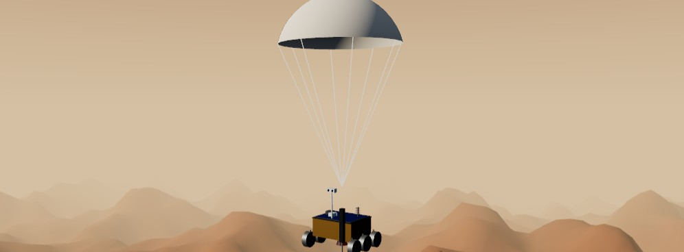 |
| Flight: lift-off | Flight: cruise | Flight: parachute over Mars |
| 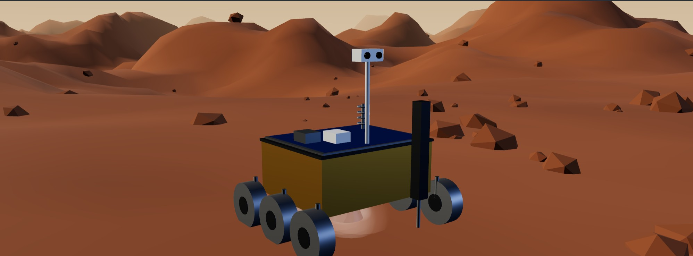 | 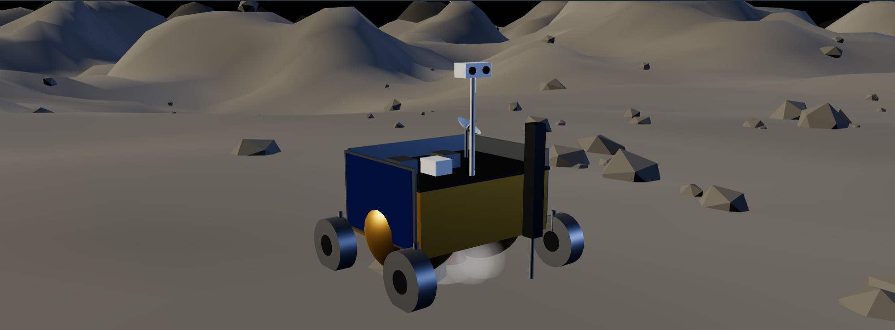 | 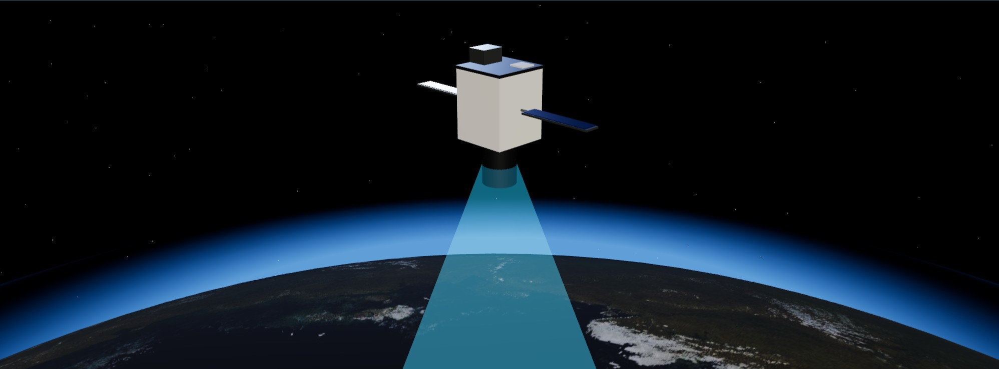 |
| Flight: rover on Mars | Flight: rover on the Moon | Flight: satellite in Earth orbit |
| 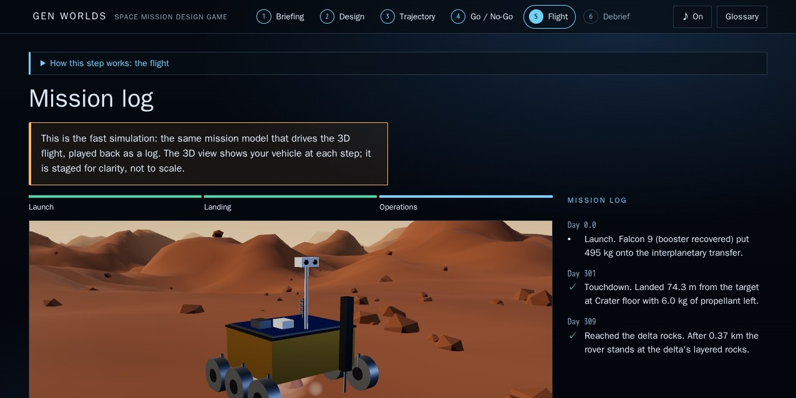 | 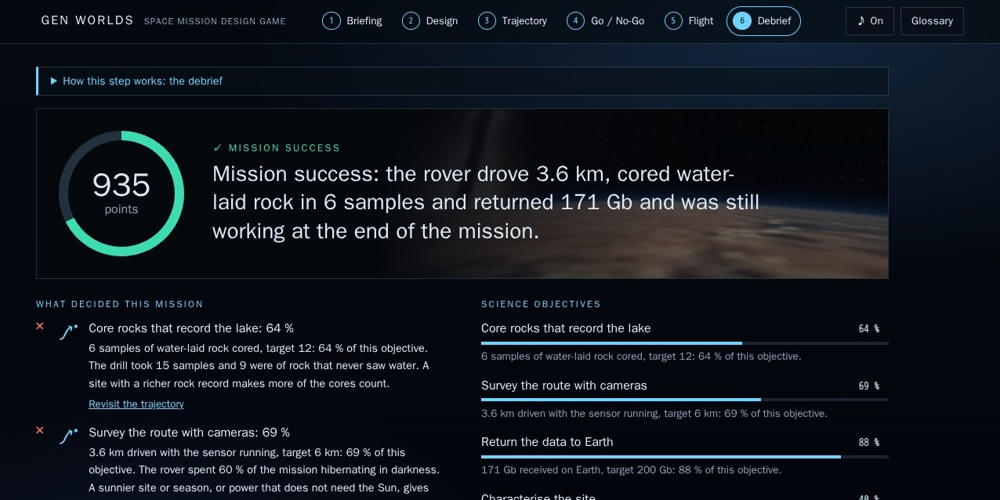 | 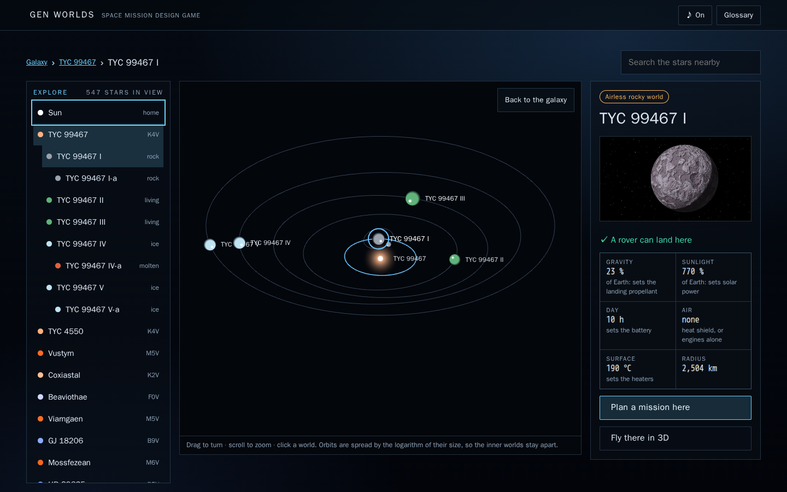 |
| Flight screen and mission log | Debrief: what decided the mission | Galaxy map: any world can be a mission |

The 3D flight shots are 1996 px wide; the others are 1280 or 1440 px. All are taken from the running
game with no retouching. The 3D stage is staged for clarity, not to scale.

## Colours and type

| Swatch | Name | Hex |
| --- | --- | --- |
|  | Space (background) | `#04070d` |
|  | Signal (accent) | `#6fd3ff` |
|  | Thruster (warning, spacecraft) | `#ffb454` |
|  | Deep orbit | `#1d5e9e` |
|  | Starlight (text) | `#eef4fb` |
|  | Dust (secondary text) | `#8fa3b8` |

Brand type is **Space Grotesk** (headlines, wordmark) and **JetBrains Mono** (labels, numbers), both
under the SIL Open Font License. The game itself uses the system UI font.

## Rebuilding the kit

Everything here is generated from the game and its data, in Docker:

```sh
docker compose run --rm capture node tools/media/build-media-kit.mjs   # logos, banners, icons, stills
docker compose run --rm capture node tools/record-video.mjs .cache/video/frames  # demo video frames
sh tools/media/encode-media.sh                                            # GIFs and MP4s (ffmpeg)
```

The banner's text is converted to outlines with the brand fonts, so it looks the same on every
machine; its turning Earth is NASA Blue Marble wrapped onto a sphere with an SVG displacement filter.
